# 🛒 Growcomers — Online Grocery Store

<p align="center">
  
</p>

<p align="center">
  <strong>A full-stack online grocery store with a DevOps implementation covering containerization, Kubernetes, Infrastructure as Code, CI/CD, security scanning, and monitoring.</strong>
</p>

<p align="center">
  <a href="https://github.com/ShahzaibGhaznavi/Growcomers-Online-Grocery-Store">
    
  </a>
  
  
  
  
  
</p>

---

## 📑 Table of Contents

- [Screenshots](#-screenshots)
- [Overview](#-overview)
- [Application Features](#-application-features)
- [DevOps Implementation](#-devops-implementation)
- [Architecture](#-architecture)
- [Technology Stack](#-technology-stack)
- [Local Setup](#-local-setup)
- [Kubernetes Deployment](#-kubernetes-deployment)
- [CI/CD and Security](#-cicd-and-security)
- [Monitoring and Alerting](#-monitoring-and-alerting)
- [Infrastructure as Code](#-infrastructure-as-code)
- [Repository Structure](#-repository-structure)
- [Security Considerations](#-security-considerations)
- [Future Improvements](#-future-improvements)
- [Credits and Contributions](#-credits-and-contributions)

---

## 📸 Screenshots

The following screenshots document the application and DevOps implementation.

### Application

| Homepage | Product Listing |
|---|---|
| 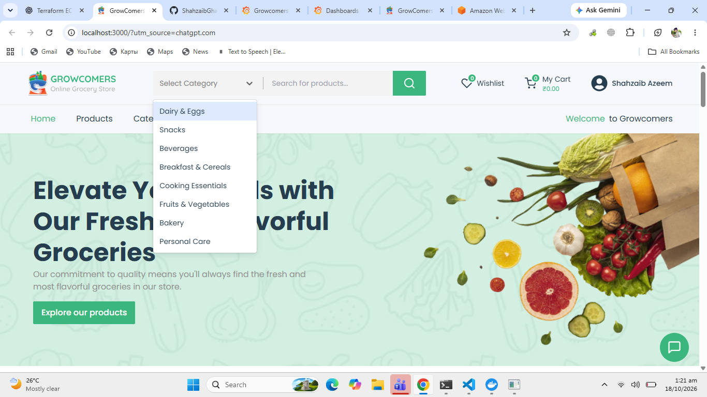 | 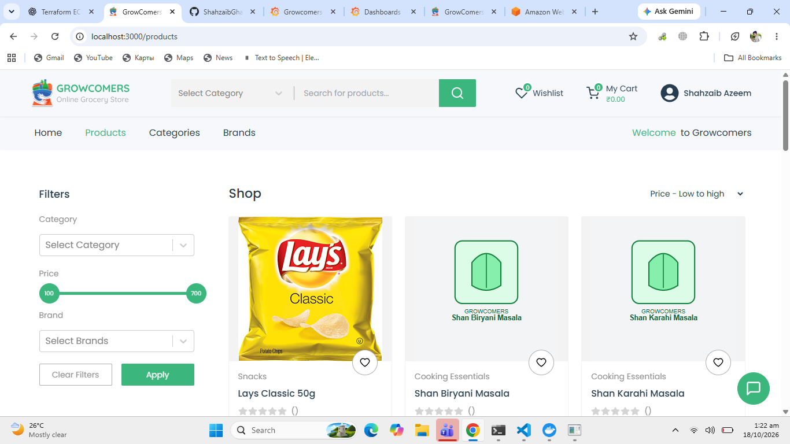 |

### Containers and Kubernetes

| Docker Containers | Kubernetes Workloads |
|---|---|
| 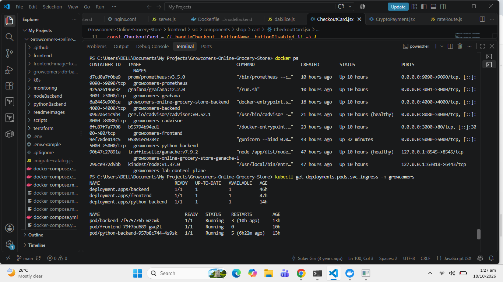 | 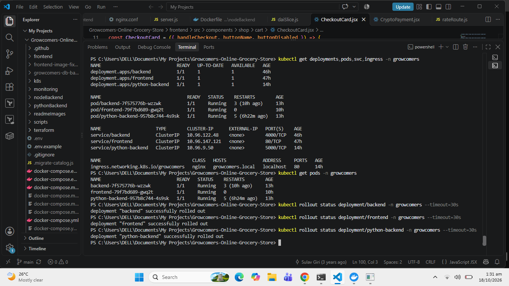 |

### Monitoring

| Prometheus Targets | Grafana Dashboard |
|---|---|
| 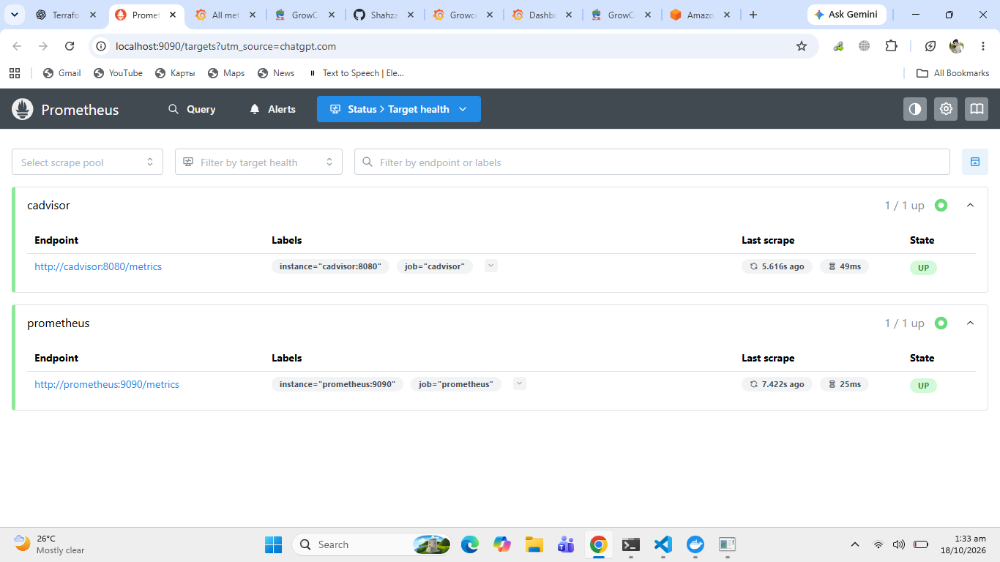 | 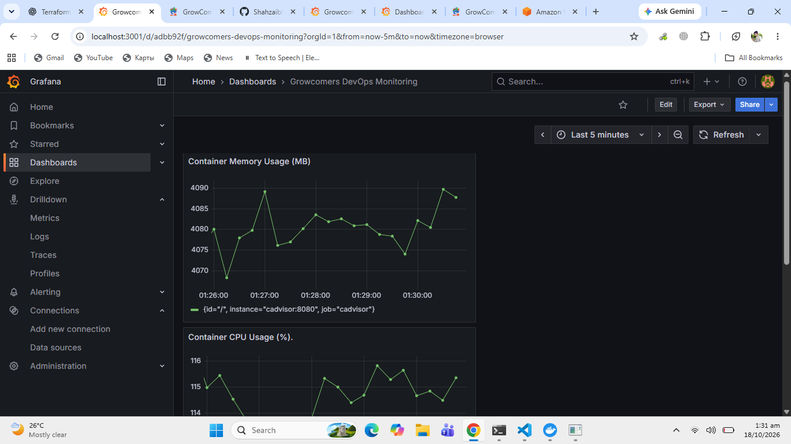 |

| Grafana Metrics |
|---|
| 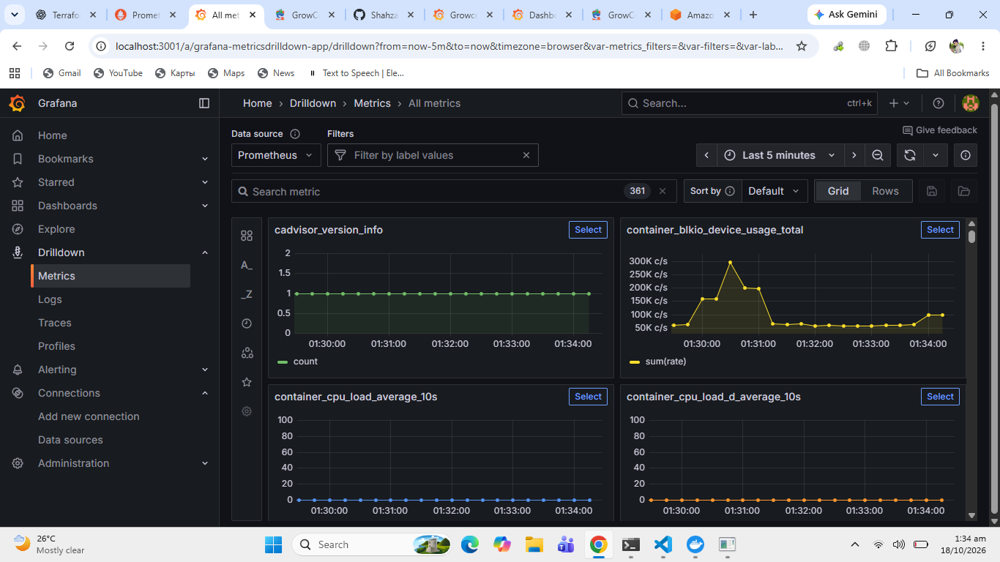 |

### Infrastructure and CI/CD

| Terraform Infrastructure | GitHub Actions CI |
|---|---|
| 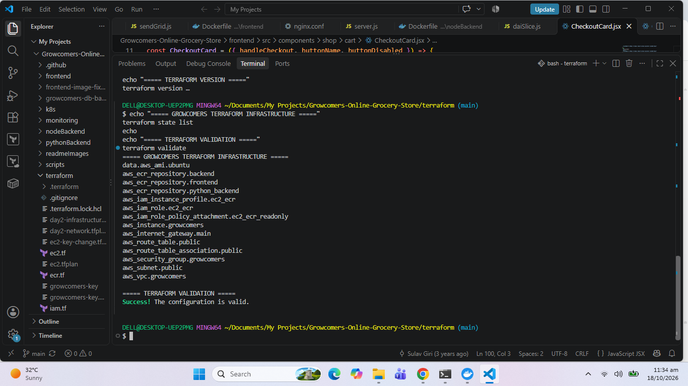 | 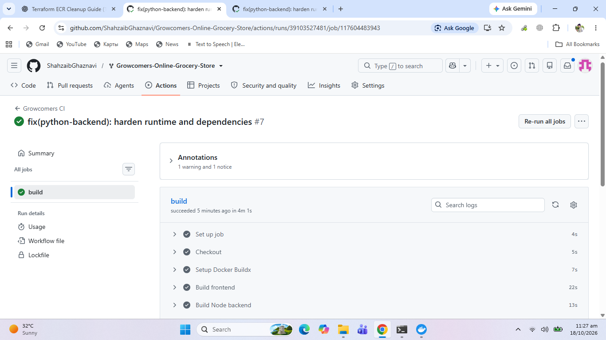 |

### AWS and Application Workflow

| AWS EC2 | AWS ECR |
|---|---|
| 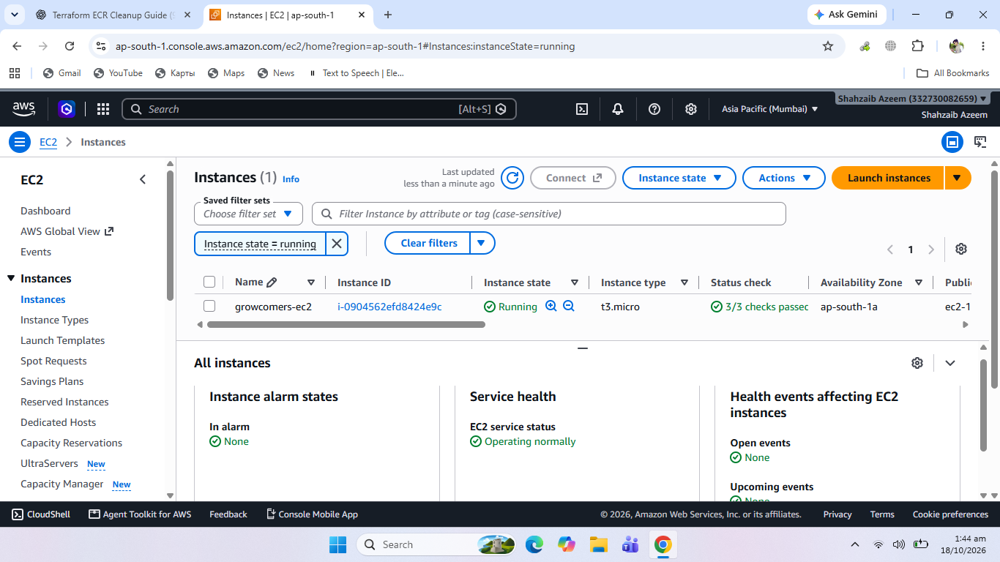 | 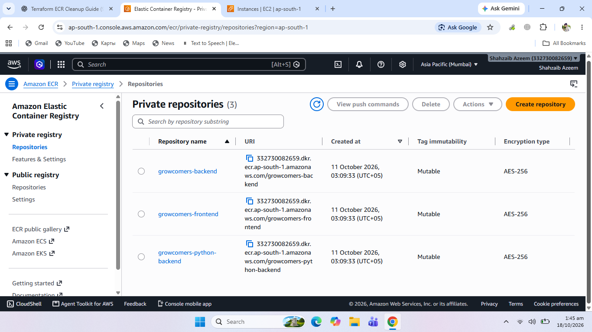 |

| Payment Workflow |
|---|
| 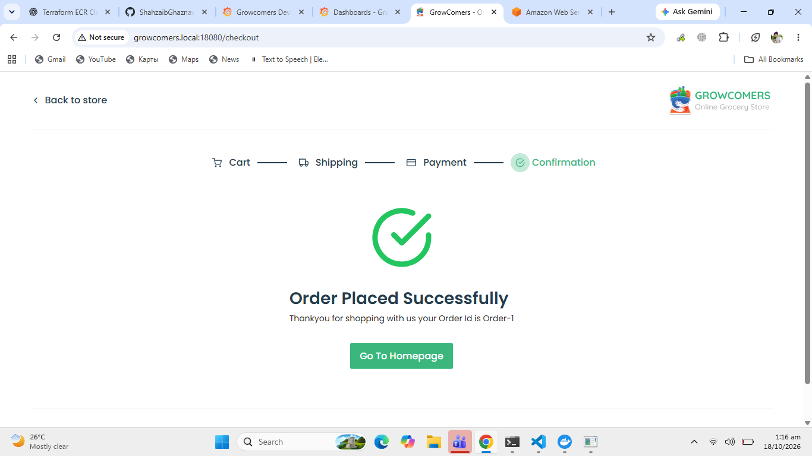 |


---

## 📌 Overview

Growcomers is an online grocery shopping application that brings together a web frontend, backend APIs, product recommendations, chatbot functionality, and blockchain-related payment components.

This repository extends the application with a practical **DevOps engineering implementation** designed to demonstrate containerization, orchestration, infrastructure provisioning, CI/CD automation, container vulnerability scanning, and observability.

The project is intended as a hands-on portfolio demonstrating how application workloads can be packaged, deployed, monitored, and managed using commonly used DevOps tools.

### Project Objectives

- Containerize the application components using Docker.
- Run the application locally using Docker Compose.
- Deploy application workloads to a Kubernetes cluster.
- Provision AWS infrastructure using Terraform.
- Build CI/CD workflows using GitHub Actions and Jenkins.
- Integrate Trivy for container image vulnerability scanning.
- Monitor container metrics using Prometheus and Grafana.
- Document deployment procedures and operational screenshots.

## 🛍️ Application Features

- User registration and login.
- Grocery product browsing and search.
- Shopping cart and checkout functionality.
- Order placement.
- Product recommendations.
- Chatbot functionality.
- Backend APIs built with Node.js and Python.
- Blockchain-related payment functionality using Ganache and smart-contract tooling.

> Application features depend on the original application implementation and its configured services.

## ⚙️ DevOps Implementation

### 1. Docker and Docker Compose

- Containerized the frontend and backend services.
- Configured multi-service orchestration through Docker Compose.
- Used environment variables for service configuration.
- Added a repeatable local development and testing workflow.
- Configured service communication within the Docker network.

### 2. Kubernetes

- Created a local Kubernetes lab using Kind.
- Deployed the frontend, Node.js backend, and Python backend.
- Organized workloads in a dedicated `growcomers` namespace.
- Configured application access through NGINX Ingress and local port forwarding.
- Added Horizontal Pod Autoscaler configurations for selected workloads.
- Validated deployments, pods, services, and resource metrics.

### 3. Terraform and AWS

- Used Terraform to define AWS infrastructure as code.
- Worked with VPC and networking configuration.
- Configured an EC2-based environment for DevOps experimentation.
- Created Amazon Elastic Container Registry (ECR) repositories for application images.
- Practiced infrastructure provisioning and teardown workflows.

AWS resources may be destroyed when not in use to control costs. Recreating the environment depends on the Terraform configuration, credentials, permissions, and current AWS service availability.

### 4. CI/CD

- Configured GitHub Actions workflow automation.
- Added Docker image build steps for application components.
- Configured Trivy scanning in the CI workflow.
- Maintained Jenkins pipeline configuration for build and security-scanning practice.
- Used Git and GitHub for version control and collaboration.

### 5. Security Scanning

- Integrated Trivy to identify known vulnerabilities in container images.
- Configured severity filtering for High and Critical findings.
- Used `ignore-unfixed` to filter vulnerabilities without available fixes.
- Reviewed dependency and base-image security findings.

**Security status:** Vulnerability scans must be evaluated against their latest reports. This README does not claim that every image is vulnerability-free or that every CI run passes.

### 6. Monitoring and Observability

- Configured Prometheus for metrics collection.
- Used Grafana to visualize monitoring data.
- Added cAdvisor for container resource metrics.
- Configured alert rules for unavailable scrape targets and high container memory usage.
- Captured monitoring dashboards and Prometheus target status for project documentation.

---

## 🏗️ Architecture

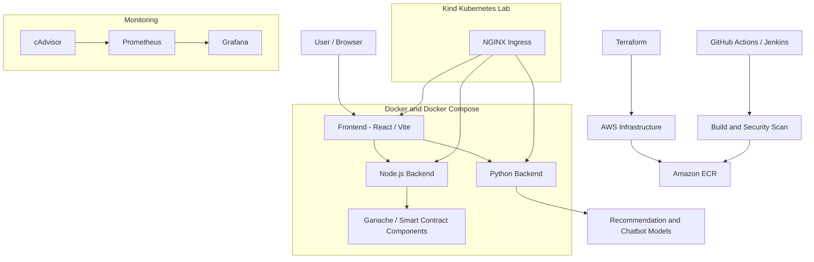

> The diagram represents the project's major components and DevOps workflows. It is a conceptual architecture, not a claim that all components run simultaneously in one production environment.

## 🧰 Technology Stack

| Category | Technologies |
|---|---|
| Frontend | React, Vite, NGINX |
| Backend | Node.js, Python, Flask |
| Database / Blockchain Components | MongoDB integration, Ganache, smart-contract tooling |
| Containers | Docker, Docker Compose |
| Orchestration | Kubernetes, Kind, NGINX Ingress |
| Infrastructure as Code | Terraform |
| Cloud | AWS EC2, VPC, ECR |
| CI/CD | GitHub Actions, Jenkins |
| Security | Trivy |
| Monitoring | Prometheus, Grafana, cAdvisor |
| Operating System / Scripting | Ubuntu, Linux, Bash |
| Version Control | Git, GitHub |

---

## 🚀 Local Setup

### Prerequisites

Install the following tools:

- Git
- Docker Desktop with Docker Compose
- Node.js and npm (for development outside containers)
- Python and pip (for development outside containers)
- `kubectl` and Kind (for Kubernetes deployment)
- Terraform and AWS CLI (for AWS infrastructure workflows)

### 1. Clone the Repository

```bash
git clone https://github.com/ShahzaibGhaznavi/Growcomers-Online-Grocery-Store.git

cd Growcomers-Online-Grocery-Store
```

### 2. Configure Environment Variables

Review the environment variable examples and configuration files provided in the repository.

Configure required secrets and application settings locally. Do not commit `.env` files, passwords, API keys, private keys, or cloud credentials.

### 3. Validate Docker Compose Configuration

```bash
docker compose config
```

### 4. Build and Start the Application

```bash
docker compose up --build -d
```

### 5. Check Running Containers

```bash
docker compose ps
```

### 6. View Application Logs

```bash
docker compose logs --tail=100
```

To follow logs continuously:

```bash
docker compose logs -f
```

### 7. Stop the Application

```bash
docker compose down
```

To remove associated Compose-managed volumes as well, review the data-loss implications before running:

```bash
docker compose down --volumes
```

### Local Service Endpoints

The following endpoints apply to the documented local development configuration when the relevant services are running.

| Service | Local Address |
|---|---|
| Frontend | `http://localhost:3000` |
| Node.js Backend | `http://localhost:4000` |
| Python Backend | `http://localhost:5000` |
| Prometheus | `http://localhost:9090` |
| Grafana | `http://localhost:3001` |
| cAdvisor | `http://localhost:8080` |
| Ganache RPC | `http://localhost:8545` |

If a service is not exposed by your active Compose configuration, use the corresponding container or Kubernetes service configuration to determine its actual endpoint.

---

## ☸️ Kubernetes Deployment

The project includes Kubernetes deployment practice using Kind.

### Verify Cluster and Namespace

```bash
kubectl cluster-info
kubectl get nodes
kubectl get namespaces
```

### Inspect Application Workloads

```bash
kubectl get deployments -n growcomers
kubectl get pods -n growcomers
kubectl get services -n growcomers
```

### Inspect Autoscaling

```bash
kubectl get hpa -n growcomers
```

### Inspect Ingress

```bash
kubectl get ingress -n growcomers
```

### Troubleshoot Workloads

```bash
kubectl describe pods -n growcomers
kubectl logs -n growcomers deployment/backend
```

Replace `backend` with the actual deployment name when troubleshooting another workload.

Kubernetes manifests, cluster configuration, image availability, and local networking must be configured before deployment. A Kind cluster is a local learning environment and is not equivalent to a managed production Kubernetes platform.

---

## 🔄 CI/CD and Security

The repository includes CI/CD workflow configuration for automated build and security-checking practice.

### GitHub Actions

Workflow files are stored in:

```text
.github/workflows/
```

The workflow is configured to build application images and run Trivy scans according to its defined triggers and steps.

View workflow execution history:

[GitHub Actions — Repository Workflows](https://github.com/ShahzaibGhaznavi/Growcomers-Online-Grocery-Store/actions)

### Trivy

Example local image scan:

```bash
trivy image --severity HIGH,CRITICAL --ignore-unfixed growcomers-frontend:ci
```

Scan the other application images by using their actual local tags.

A non-zero scan exit code can indicate that findings match the configured failure policy. Review the full scan output before deciding whether to upgrade packages, change base images, or adjust the policy.

### Jenkins

Jenkins pipeline configuration is included for CI/CD practice. A successful pipeline requires a running Jenkins instance, configured credentials, accessible build agents, and correctly configured Docker access.

---

## 📊 Monitoring and Alerting

Prometheus and Grafana are used to demonstrate monitoring and visualization of container metrics.

### Monitoring Components

- **Prometheus:** Collects metrics from configured scrape targets.
- **Grafana:** Provides dashboards for reviewing collected metrics.
- **cAdvisor:** Exposes container resource metrics.

### Configured Alert Rules

| Alert | Condition | Duration |
|---|---|---|
| `PrometheusTargetDown` | A monitored target is unavailable | 2 minutes |
| `ContainerMemoryHigh` | Container memory usage exceeds 1 GiB | 5 minutes |

These conditions describe the configured alert rules; an alert only fires when its expression evaluates as configured and the required duration is satisfied.

### Access Monitoring

- Prometheus: `http://localhost:9090`
- Grafana: `http://localhost:3001`

The documented Grafana dashboard path is:

`/d/adbb92f/growcomers-devops-monitoring`

Full dashboard access depends on Grafana being running and the dashboard being provisioned or imported.

> The current monitoring setup demonstrates container-level observability. Do not assume that Kubernetes pod metrics, application-level metrics, or every infrastructure component are monitored unless their exporters and scrape targets are explicitly configured.

---

## ☁️ Infrastructure as Code

Terraform configuration is used to describe and manage AWS resources.

### Typical Workflow

Initialize Terraform:

```bash
terraform init
```

Validate configuration:

```bash
terraform validate
```

Review the planned changes:

```bash
terraform plan
```

Apply reviewed changes:

```bash
terraform apply
```

Destroy managed infrastructure when it is no longer needed:

```bash
terraform destroy
```

**Important:** Review the plan before applying or destroying resources. Destroying infrastructure can permanently remove resources and data. Terraform can recreate only the resources represented in its configuration and state, and successful recreation depends on valid credentials, permissions, dependencies, and current provider/API behavior.

AWS can incur charges while resources are running. Check EC2, EBS, ECR storage, public IPv4 addresses, snapshots, and other billable resources before and after lab sessions. Deleting Terraform-managed resources does not automatically guarantee that every related or independently created AWS resource has been removed.

---

## 📁 Repository Structure

```text
Growcomers-Online-Grocery-Store/
├── .github/
│   └── workflows/
├── frontend/
├── nodeBackend/
├── pythonBackend/
├── screenshots/
├── readmeImages/
├── terraform/
├── k8s/
├── monitoring/
├── docker-compose.yml
├── Jenkinsfile
└── README.md
```

> Directory names may differ depending on the current repository version. Check the actual repository contents for the exact Terraform, Kubernetes, and monitoring paths.

---

## 🔐 Security Considerations

- Keep secrets out of source control.
- Use environment variables or a suitable secret-management system for sensitive configuration.
- Scan container images and review vulnerability reports.
- Prefer maintained base images and patched dependencies.
- Apply least-privilege IAM permissions.
- Restrict public access to cloud resources and administrative dashboards.
- Avoid committing real credentials, production data, or sensitive Terraform state.
- Review infrastructure plans before making changes.
- Re-run security scans after dependency or base-image updates.

Security scanning helps identify known vulnerabilities but does not guarantee that an application or deployment is completely secure.

---

## 🛣️ Future Improvements

- Add automated application tests to CI.
- Improve image tagging and immutable artifact management.
- Add Kubernetes readiness and liveness probes where appropriate.
- Integrate Kubernetes metrics using a suitable metrics pipeline.
- Add centralized logs and application-level observability.
- Introduce GitOps-based deployment automation.
- Strengthen secrets management and IAM policies.
- Add dependency scanning and software supply-chain controls.
- Document repeatable environment setup and teardown.
- Add deployment verification and rollback procedures.

---

## 👨‍💻 Credits and Contributions

### Original Application

The original Growcomers application was developed by **Shubham**.

- Original repository: [shubham7227/Growcomers-Online-Grocery-Store](https://github.com/shubham7227/Growcomers-Online-Grocery-Store)

### DevOps Implementation

**Shahzaib Azeem**

DevOps work documented in this repository includes containerization, Docker Compose configuration, Kubernetes deployment practice, Terraform-based AWS infrastructure, CI/CD workflows, Trivy security scanning, and Prometheus/Grafana monitoring.

- GitHub: [ShahzaibGhaznavi](https://github.com/ShahzaibGhaznavi)
- Project Repository: [Growcomers-Online-Grocery-Store](https://github.com/ShahzaibGhaznavi/Growcomers-Online-Grocery-Store)
- LinkedIn: [Shahzaib Azeem](https://www.linkedin.com/in/shahzaib-azeem-6415091b/)

---

<p align="center">
  <strong>Built to practice and demonstrate real-world DevOps workflows.</strong>
</p>

<p align="center">
  <sub>Educational portfolio project. Review configuration, security, cost, and operational requirements before using any component in production.</sub>
</p>
